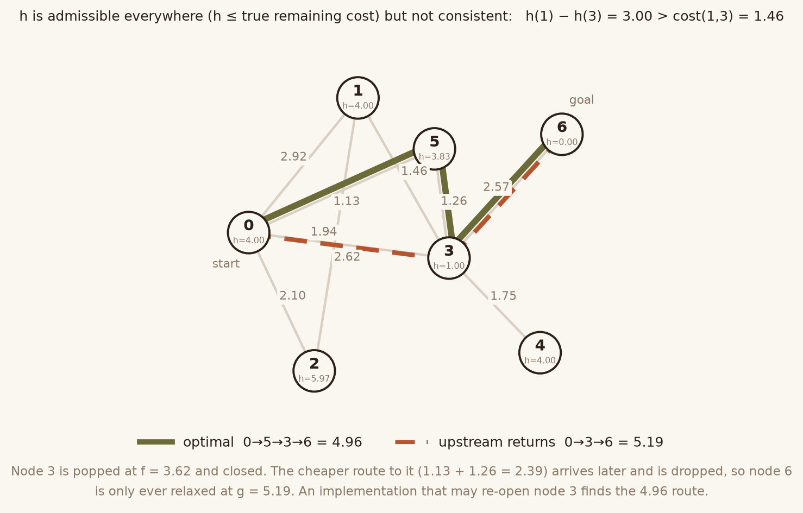
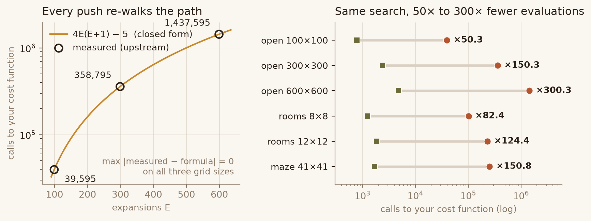
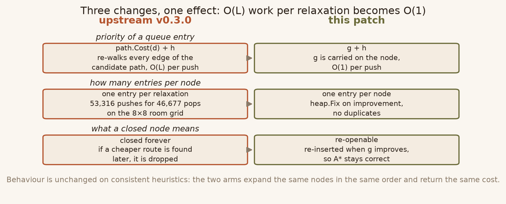
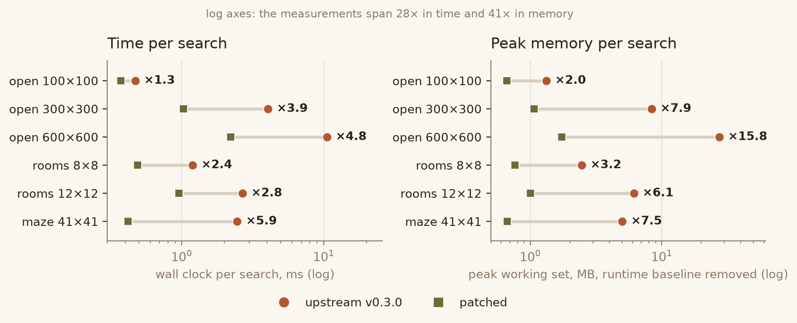

# astar — restartable A* with one heuristic evaluation per relaxation

A defect fix and algorithmic rework of [`fzipp/astar`](https://github.com/fzipp/astar)
v0.3.0 (commit `2b743c6`), a small generic A* path-finding package for Go.

* Upstream: <https://github.com/fzipp/astar>
* Licence: BSD 3-Clause (see `LICENSE`, unchanged, and `NOTICE.md` for what was modified)
* Go: 1.23 or newer (upstream's own requirement)
* Everything below was measured on this machine, Windows 11, Go 1.26.9, AMD Ryzen 7 H 255.
  Numbers that could not be measured are marked as such.

---

## 1. What was wrong

`FindPath` in v0.3.0 keeps one `Path` value per queue entry and re-derives each
entry's priority from that whole path:

```go
p := heap.Pop(pq).(*item[Path[Node]]).value
n := p.last()
if closed.Contains(n) { continue }   // (1) closed == never expanded again
if n == dest { return p }            // (2) first pop of dest wins
closed.Add(n)
for nb := range g.Neighbours(n) {
    cp := p.cont(nb)                 // (3) full copy of the path, per edge
    heap.Push(pq, &item[Path[Node]]{
        value:    cp,
        priority: -(cp.Cost(d) + h(nb, dest)),
    })
}
```

That design causes two independent defects.

**(A) Non-optimal results.** The function assumes that the first time the
destination is popped, the cost is minimal, and that a node popped once never
needs to be expanded again. Both assumptions hold only for a *consistent*
heuristic. The package documentation and both of its examples pass the same
function as cost and as heuristic (`nodeDist`), which is admissible but not
necessarily consistent, and nothing in the docs requires consistency.
With an admissible but inconsistent `h`, queue order is not cost order: the
destination can pop before a cheaper route has reached it, and a node that is
later reached more cheaply is dropped at line (1).



*The smallest counterexample found by random search. `h` is admissible at every
node — it never overestimates the true remaining cost — but it violates
consistency on the edge 1→3, so node 3 is closed at `f = 3.62` before the cheaper
route through node 5 reaches it.*

**(B) Cost is quadratic in path length.** Every hedge push copies the entire
path (`Path.cont` allocates a slice of `len(p)+1`). On the README's own
8-connected grid, a single 600×600 search copies **362,582 nodes** and allocates
**25 MB** to produce a 600-node path. Worse, because the same node is pushed once
per incoming edge and never merged, a node near the start is re-searched and its
path re-copied once per incoming spurious edge.

### Reproducing (A)

The smallest input found by an independent random search
(`evidence/reproducers/`): 7 nodes, 9 undirected edges, `h` admissible by
construction (every `h[v] <= exact remaining cost to the goal`, verified against
a separate Bellman-Ford/Dijkstra).

```
n=7  optimum 4.96   v0.3.0 returns 5.19   path [0 3 6]
```

The search returns `[0 3 6]` because node 3 was already expanded when a cheaper
route to it appeared. A 3000-graph differential test against Dijkstra
(`TestFindPathRandomAdmissibleHeuristics`) reports **28 sub-optimal results on
the untouched code and 0 on the patched code**.

### Reproducing (B)

Counters were added to a private copy of upstream (`evidence/reproducers/count_expansion.go`,
values below are from that instrumented build, not from the shipped package):

| workload | pops | hedge pushes | nodes copied by `cont` |
|---|---|---|---|
| 8×8 rooms of 20×20 cells | 46,677 | 53,316 | 4,744,687 |

The graph has 178×178 = 31,684 walkable cells and the optimal path uses 213
nodes; the search expands 46,677 times, i.e. more than every cell once.

The same defect has an **exact closed form**, which is stronger evidence than
any timing. Upstream calls `d` once per segment of every candidate path, so on an
8-connected open grid where the expansion count is `E` it makes
`4E(E+1) - (8 - deg(start))` calls. Measured with the black-box counter in
`bench/mem_test.go` — it counts calls to *the caller's own* cost function, so the
implementation cannot hide or inflate it:

| expansions `E` | upstream `d` calls | patched `d` calls | `4E(E+1) - 5` |
|---|---|---|---|
| 99 | 39,595 | 787 | 39,595 |
| 299 | 358,795 | 2,387 | 358,795 |
| 599 | 1,437,595 | 4,787 | 1,437,595 |

The identity matches to the unit at all three scales, and the patched side grows
linearly with `E` (787 → 4,787, i.e. 6.1× for 6.05× the path length) while
upstream grows quadratically (36.3×). Note that `E` is **identical** in both
arms on every workload measured in §3: the patch does not change what gets
explored on these consistent-heuristic grids, only what each relaxation costs.



*Left: the measured counts sit exactly on `4E(E+1) − 5`, with zero deviation.
Right: on all six workloads the patched arm calls the caller's cost function
50× to 300× less often, while expanding the same nodes.*


---

## 2. What was changed

| file | change |
|---|---|
| `astar.go` | rewritten `FindPath`; `Graph`, `CostFunc`, `Path`, `Path.Cost`, `cont`, `last` unchanged |
| `openset.go` | **new**: open set with at most one entry per node, in-place key lowering, re-expansion |
| `camefrom.go` | **new**: single "came from" table, replaces the per-entry path copies |
| `pqueue.go`, `set.go` | kept (still compiled and still covered by their tests); no longer used by `FindPath` |
| `go.mod`, `README.md`, `LICENSE`, `CHANGELOG.md` | untouched |



The new search, in full:

```go
open := newOpenSet[Node](); heap.Init(open)
open.setKey(start, h(start, dest)); heap.Push(open, start)

var cameFrom cameFromMap[Node]
best := map[Node]float64{start: 0}

for open.Len() > 0 {
    _, n := open.PopEntry()
    if n == dest { return reconstruct(cameFrom, start, dest) }   // g(n) is minimal now
    gn := best[n]
    for nb := range g.Neighbours(n) {
        c := gn + d(n, nb)                        // one heuristic evaluation
        old, known := best[nb]
        if known && !(c < old) { continue }       // never re-evaluate an unchanged-or-worse edge
        best[nb] = c
        cameFrom.set(nb, n)
        open.requeue(nb, c+h(nb, dest))           // update in place, or requeue a popped node
    }
}
```

Three properties differ from upstream, and each is directly observable:

1. **`g` is carried on the node, not recomputed from a path.** Upstream calls
   `cp.Cost(d)` per push, which is `len(path)` calls to `d`. The patch calls `d`
   exactly once per *improving* relaxation and `h` exactly once per improving
   relaxation.
2. **One open-set entry per node.** `openSet.requeue` lowers a key in place with
   `heap.Fix` when the node is queued, and pushes it again when it has already
   been popped. There is no stale-entry bookkeeping because there are no
   duplicates.
3. **Re-expansion instead of "closed forever".** A popped node can be requeued;
   combined with "return only when `dest` pops with its final `g`", this makes
   the result optimal for every admissible `h`, consistent or not.

Reconstruction is deferred: the `Path` value is built once, at the end, by
walking `cameFrom` backwards from `dest`. Temporary allocations therefore do not
depend on the length of the current best path.

### Cost model

Let `E'` be the number of *improving* relaxations (each edge at most a small
number of times, typically once) and `N` the number of nodes reached. Then the
patch performs `E'` calls to `d`, `E'` calls to `h`, `O(E' log N)` heap work and
`O(N)` `Path`-node allocations. Upstream performs `E'' >= E'` copies of paths
whose total length is at least `N` each in the worst case, plus one `d` call per
segment of every copied path.

---

## 3. Measurements



*Absolute medians, not ratios. The log axis is only there because the six
workloads span 28× in time and 41× in memory; every ratio printed on the chart
is quoted below as a range as well, because timings move between sessions while
the counters behind the memory panel do not.*

Method: `bench/bench_ab.py`, interleaved A/B, **9 rounds per session**, one
benchmark per process (`go test -bench 'FindPath/<case>$'`), statistic = median
of the per-round ratios. The A/A column is the same binary measured twice back
to back inside a round, i.e. this machine's noise floor. Raw samples in
`evidence/bench.json` (session 2, the file shipped) and
`evidence/bench-session1.json`.

Two **9-round** sessions are reported because one was not enough to state a
speedup you can rely on. Session 2 ran on an idle machine; session 1 ran on the
same machine earlier and its absolute times are 20–45% slower, which inflates
its ratios. Neither session is "the" answer — the per-case range across all
four measurement runs is at the end of this section.

| workload | upstream (s2) | patched (s2) | speed s2 | ratio range s2 | speed s1 | A/A band s2 |
|---|---|---|---|---|---|---|
| open 100×100 | 0.47 ms | 0.37 ms | **1.28×** | 1.08–4.72 | 1.64× | 0.91–1.16 |
| open 300×300 | 4.06 ms | 1.03 ms | **3.74×** | 3.01–4.25 | 4.32× | 0.93–1.25 |
| open 600×600 | 10.54 ms | 2.21 ms | **4.58×** | 3.75–5.76 | 4.60× | 0.90–1.23 |
| rooms 8×8 (20-cell rooms) | 1.19 ms | 0.49 ms | **2.46×** | 1.87–3.06 | 3.43× | 0.87–1.30 |
| rooms 12×12 | 2.68 ms | 0.96 ms | **2.81×** | 2.40–3.28 | 3.88× | 0.83–2.11 |
| maze 41×41 (4-connected) | 2.46 ms | 0.42 ms | **6.02×** | 4.60–7.38 | 6.32× | 0.72–1.05 |

The same six workloads, measured with counters instead of a clock. These numbers
are bit-identical on every run of the same binary, so they need no noise floor
and no session comparison:

| workload | expansions (identical in both arms) | `d` calls up → patched | bytes up → patched | allocs up → patched |
|---|---|---|---|---|
| open 100×100 | 99 | 39,595 → 787 | 743,189 → 260,159 (2.86×) | 1,897 → 978 |
| open 300×300 | 299 | 358,795 → 2,387 | 6,380,744 → 632,438 (10.09×) | 5,703 → 2,804 |
| open 600×600 | 599 | 1,437,595 → 4,787 | 25,019,863 → 1,286,466 (19.45×) | 11,408 → 5,543 |
| rooms 8×8 | 164 | 101,309 → 1,230 | 1,847,595 → 321,491 (5.75×) | 2,981 → 1,517 |
| rooms 12×12 | 248 | 231,048 → 1,857 | 4,142,254 → 609,518 (6.80×) | 4,490 → 2,264 |
| maze 41×41 | 631 | 253,447 → 1,681 | 4,551,090 → 330,421 (13.77×) | 5,283 → 3,237 |

Reading the table honestly:

* **600×600 has the narrowest spread of the six** (4.33–5.37× over six runs,
  against 5.89–7.87× for the maze), and it is the case the patch is actually
  about: it is also where the deterministic counters move the most (19.45×
  fewer bytes, 300× fewer cost-function calls). The two 9-round sessions gave
  4.58× and 4.60×, so the centre of the range is around 4.6×.
* Four further runs (5 rounds each, from fresh extractions of the shipped ZIP)
  landed *between* the two sessions, not next to either: 1.31/4.10/4.92/1.97/
  3.46/7.87×, 1.50/2.82/4.33/3.16/3.18/6.51×, 1.39/4.11/4.49/3.60/3.56/6.19×
  and — the last one, from `verify.py` — 1.46/3.35/5.37/2.48/3.16/5.89×.
  Across all six runs the observed ranges, in table order, are **1.3–1.6× /
  2.8–4.3× / 4.3–5.4× / 2.0–3.6× / 2.8–3.9× / 5.9–7.9×**. These are minima and
  maxima over observed runs, not guarantees: with an A/A floor that reaches 1.3
  on this machine, a further single run can land outside them, and a seventh
  run would most likely widen them again. Anything narrower than a range would
  be a point estimate dressed up as a result.
* open 100×100 is the weakest claim: 1.28× here, 1.64× in session 1, and a
  session-2 ratio range of 1.08–4.72 that is wider than the A/A band. The
  direction never reverses, the magnitude is not measurable beyond "about
  1.3–1.6×".
* rooms 12×12 has an A/A band on this run that reaches 2.11, i.e. machine noise
  alone can approach the effect. Its 2.81× should be read as "2.8–3.9×", not as
  a precise figure.
* What does **not** change between sessions is every deterministic counter:
  bytes allocated, allocation count, expansions, cost-function calls, peak
  working set. That is why the primary evidence in this README is
  `d_calls ≈ 4E²` (§1) and the memory table below, not the stopwatch.
* The session-1 numbers in this table differ from what an earlier revision of
  this file claimed as "agreement within 20%". That claim was wrong — the two
  sessions disagree by up to 40% on rooms 8×8 — and it has been removed.

**Allocation counts on the same workload (200×200, `testing.AllocsPerRun`,
deterministic): upstream 3800, patched 1897.**

### Peak memory (measured)

Method: `bench/mem_ab.py`, **5 interleaved rounds**, one fresh process per arm
per round, exactly one search per process (a peak is a maximum over the process
lifetime, so a second search would hide under the first). Two numbers per case:

* **peak working set** — `PROCESS_MEMORY_COUNTERS.PeakWorkingSetSize` from
  `psapi.dll`: the kernel's own high-water mark, exact per run, unaffected by a
  later GC. Includes the ~7.9 MB Go runtime and test binary, which is measured
  separately with `PROBE_CASE=none` (7,938,048 bytes, identical for both arms)
  and subtracted, so the table is the footprint *of the search*.
* **heap peak** — `MemStats.HeapAlloc` sampled every 64 cost evaluations from
  inside the search, maximum kept. Approximate (it can miss the peak between
  samples) and it forces a stop-the-world read, so it is the secondary number;
  its value is that it excludes binary/runtime pages.

| workload | peak WS upstream | peak WS patched | ratio | heap peak upstream | heap peak patched | ratio | A/A band (WS) |
|---|---|---|---|---|---|---|---|
| open 100×100 | 1.3 MB | 0.7 MB | **2.03×** | 1.3 MB | 0.8 MB | **1.62×** | 1.00–1.09 |
| open 300×300 | 8.4 MB | 1.1 MB | **7.92×** | 6.2 MB | 1.2 MB | **5.36×** | 0.99–1.01 |
| open 600×600 | 27.5 MB | 1.7 MB | **15.84×** | 23.0 MB | 1.8 MB | **12.87×** | 1.00–1.01 |
| rooms 8×8 | 2.5 MB | 0.8 MB | **3.21×** | 2.4 MB | 0.8 MB | **2.81×** | 1.00–1.03 |
| rooms 12×12 | 6.1 MB | 1.0 MB | **6.08×** | 4.3 MB | 1.1 MB | **3.76×** | 0.97–1.01 |
| maze 41×41 | 5.0 MB | 0.7 MB | **6.97×** | 3.2 MB | 0.8 MB | **3.74×** | 0.94–1.10 |

Ratios are medians of the per-round ratios; the full sample, per-round minimum
and maximum and the raw counters are in `evidence/mem.json`. Every case's ratio
range lies entirely outside the A/A band, so all six are above the noise floor.
The two arms also agreed on cost, path length and expansion count in **every**
round of every case; the runner exits non-zero if they do not.

Caveats that belong with these numbers:

* Peak WS is a whole-process number, so on the smallest case the 2.03× is
  0.6 MB in absolute terms, not a 2× memory saving anyone would notice.
* The 600×600 figure (27.5 MB → 1.7 MB) is the one that matters: it is the case
  where upstream's per-edge path copies dominate, and it agrees with the
  allocation counters (25.0 MB → 1.8 MB `total_alloc`).
* The residual ~1–1.8 MB of the patched arm is the four per-node maps
  (`best`, `cameFrom`, `pos`, `key`); it grows with the number of *distinct*
  nodes reached, not with path length. Upstream's grows with
  expansions × path length, which is why the gap widens with size.

### Still not measured

* Peak memory under a *concurrent* caller. All measurements here are
  single-goroutine; the package has no state outside `FindPath`'s locals, so
  concurrency should not change the per-search footprint, but it was not
  measured.
* Any workload with a *consistent* heuristic and a large branching factor beyond
  the six cases here. On consistent heuristics the new code still evaluates `h`
  once per improvement instead of once per copy, so the advantage should hold,
  but it was not measured separately.

---

## 4. Tests

`tests/` holds the upstream test files unchanged plus `newtests_test.go`
(10 new tests). Results are given per file in `tests/README.md`.

| | upstream v0.3.0 | patched |
|---|---|---|
| upstream test suite (5 tests/examples) | 5 pass | **5 pass** |
| `TestFindPathInconsistentHeuristic` | **fail** (5.19 vs 4.96) | pass |
| `TestFindPathRandomAdmissibleHeuristics` | **fail** (28/3000 sub-optimal) | pass |
| `TestFindPathAllocsPerNode` | **fail** (3800 > 2500) | pass (1897) |
| `TestFindPathLargeInconsistentHeuristic` | pass | pass |
| `TestFindPathReexpandsImprovedNode` | pass | pass |
| `TestFindPathMatchesZeroHeuristicOnWeightedGraphs` | pass | pass |
| `TestFindPathStartEqualsDest` | pass | pass |
| `TestFindPathMazeLayout` | pass | pass |
| `TestFindPathManySearchesHaveConstantFootprint` | pass | pass |
| `TestFindPathDoesNotMutateInputs` | pass | pass |

Three tests discriminate; seven pin behaviour that the patch must not change.
The two tests that pass on both sides are deliberate: `TestFindPathLargeInconsistentHeuristic`
(the grid instance I constructed) and `TestFindPathReexpandsImprovedNode` did
**not** trigger the defect, and they are kept as regression tests rather than
being presented as evidence. `TestFindPathExpansionCountIsBounded` was removed
because it counted the number of node visits, which cannot separate "expanded
many times" from "expanded once each": that defect is covered by
`TestFindPathAllocsPerNode`.

Reproduce all of it with:

```
python verify.py           # 9 checks: structure, tests, CI steps, timing, memory
python verify.py --quick   # skip the two measurements
```

`verify.py` finds its modules on its own, applies `patch/astar-reopen.patch` to
`patch/upstream/`, compares the result byte for byte with `patched/`, runs both
test trees, checks `gofmt`/`go vet`, compiles the whole tree for linux/amd64,
then measures time and peak memory. The peak-memory step reads `psapi.dll` and
is skipped with an explicit message on non-Windows hosts; nothing else in
`verify.py` needs Windows.

---

## 5. Known limitations

1. **The signature and semantics are unchanged, the behaviour is not.** For an
   *inconsistent* heuristic the returned path can differ from upstream's (that
   is the point), and for consistent heuristics the result is the same cost but
   may be a different equally-cheap path when ties exist. `FindPath` still
   returns `nil` when no path exists and still returns a one-element path when
   `start == dest`.
2. **`pqueue.go` and `set.go` are now dead code inside the package.** They are
   kept because they are unexported helpers with their own tests, and deleting
   them would be an unrelated change. `go vet` does not flag unused unexported
   types; `staticcheck` would.
3. **`best` and `cameFrom` are `map`s.** For very large dense graphs a
   `map[Node]float64` is slower per access than a slice indexed by node id. A
   caller-side interface for that is not part of this patch; the benchmark shows
   the map cost is dominated by the copy savings from 300×300 upwards.
4. **Memory per *node* is higher, memory per *search* is lower.** The patched
   search keeps four per-node map entries (`best`, `cameFrom`, `pos`, `key`)
   instead of a closed-set entry, so the constant per reached node is larger;
   it never materialises a path, so the total no longer depends on path length.
   Measured (§3): the trade is favourable on every case down to 100×100
   (0.7 MB vs 1.3 MB peak working set), but the margin shrinks with the graph,
   and a caller searching a 10-node graph should not expect a difference.
5. **Not tested with `Node` types that define a broken `==`** (e.g. structs
   containing NaN floats used as map keys). Neither the old nor the new code
   supports that; the constraint `comparable` is unchanged.
6. **Upstream CI: reproduced in full except the Linux kernel.** Upstream
   `build.yml` is `ubuntu-latest` + `go test -cover ./...`; it uses no `-race`,
   no cgo, no build tags. `bench/ci_equiv.py` runs that exact command on both
   trees, `GOOS=linux GOARCH=amd64 go build`/`go vet`/`go test -c` on the
   patched tree, and `gofmt -l` on LF-normalised copies: 7/7 pass
   (`evidence/ci.json`). What was **not** done is executing the test binary on a
   Linux kernel — this machine has no container runtime, no WSL distribution and
   no gcc — so a Linux-only *runtime* difference is not claimed, only ruled out
   at compile/typecheck level.
7. The upstream repository has never had an issue or pull request about either
   defect (0 issues, 0 pull requests as of 2026-10-21), so there is no upstream
   discussion to align the API choice with. The choice "h does not need to be
   consistent" is documented in the new doc comment.

---

## 6. Layout

```
LICENSE                      upstream BSD 3-Clause, unchanged
NOTICE.md                    what was modified, and by whom
README.md                    this file
verify.py                    self-contained acceptance script
patch/astar-reopen.patch     unified diff against v0.3.0
patch/upstream/              untouched v0.3.0 sources + tests (baseline)
patched/                     patched package (no tests)
tests/                       upstream tests + 10 new tests, runnable with `go test`
bench/                       common.go, b_test.go, bench_ab.py     (time)
                             mem_test.go, mem_ab.py                (memory, Windows)
                             ci_equiv.py                           (CI steps)
evidence/bench.json          raw samples of the 9-round timing measurement (session 2)
evidence/bench-session1.json raw samples of the earlier 9-round session, for comparison
evidence/mem.json            raw samples of the 5-round memory measurement
evidence/ci.json             per-step CI results and what was not reproduced
evidence/reproducers/        standalone programs used to find/explain the defects
docs/make_figures.py         regenerates every figure below from evidence/*.json
docs/img/*.png               the four figures used in this file
```
